# Fitness Center Analytics on SAP HANA Cloud

An analytics data model for a fitness center, built in SAP HANA Cloud during the EPAM BI training program (SAP HANA Cloud development).
It turns raw bookings, classes, members and trainers into a layered model of reporting views: revenue by month and category, trainer performance, member spending, ranking and multi-currency prices.

## Database

The source data lives in five column tables. Bookings link members to classes, and every class has one trainer.

| Table | Key columns | Content |
|---|---|---|
| `BOOKINGS` | `ID` (PK), `MEMBER_ID`, `CLASS_ID` | One row per booking: member, class, booking date, status |
| `CLASSES` | `ID` (PK), `TRAINER_ID` | Class name, category, price, capacity, class date, currency |
| `MEMBERS` | `ID` (PK) | Name, email, phone, membership type and price, join and end dates, status |
| `TRAINERS` | `ID` (PK) | Name, specialization, email, phone, hire date |
| `EXCHANGE_RATES` | `SOURCE_CURRENCY`, `TARGET_CURRENCY`, `VALID_FROM` (PK) | Currency rate valid from a date, used for price conversion |

Relationships: `BOOKINGS.MEMBER_ID → MEMBERS.ID`, `BOOKINGS.CLASS_ID → CLASSES.ID`, `CLASSES.TRAINER_ID → TRAINERS.ID`.

### Star schema

`CV_SALES_STAR_SCHEMA` joins one bookings fact to three dimensions (classes, members, trainers) with left outer, many-to-one joins.
Calculated columns are built inside the model: `TRAINER_SHARE` on the fact, `CLASS_FULL_NAME` and `PRICE_RANGE` on the classes dimension.

## Architecture

The model is deployed as an HDI container and organised in layers, each reading only from the layer below it.

```mermaid
flowchart LR
    subgraph T["Tables"]
        B[BOOKINGS]
        C[CLASSES]
        M[MEMBERS]
        TR[TRAINERS]
        X[EXCHANGE_RATES]
    end
    subgraph S["Staging"]
        S1[CV_BOOKINGS_STG]
        S2[CV_CLASSES_DIM]
        S3[CV_MEMBERS_DIM]
        S4[CV_TRAINERS_DIM]
    end
    subgraph I["Intermediate"]
        I1[CV_BOOKINGS_WITH_CLASSES]
        I2[CV_BOOKINGS_AGGREGATED]
        I3[CV_BOOKINGS_COMBINED]
        I4[CV_CLASSES_FILTERED]
    end
    subgraph R["Reporting"]
        R1[Star schema and cubes]
        R2[Analytical SQL views]
        R3[Secured views]
    end
    T --> S --> I --> R
```

## What is in each layer

### Tables

See [Database](#database) above.

### Staging (`src/STAGING`)

| View | Purpose |
|---|---|
| `CV_BOOKINGS_STG` | Bookings prepared for the upper layers |
| `CV_CLASSES_DIM` | Classes dimension with `CLASS_FULL_NAME` and `PRICE_RANGE` |
| `CV_MEMBERS_DIM` | Members dimension |
| `CV_TRAINERS_DIM` | Trainers dimension |

### Intermediate (`src/INTERMEDIATE`)

| View | Purpose |
|---|---|
| `CV_BOOKINGS_WITH_CLASSES` | Join of bookings and classes; the fact for the star schema |
| `CV_BOOKINGS_AGGREGATED` | Bookings joined and aggregated for reporting |
| `CV_BOOKINGS_COMBINED` | Union of active and cancelled bookings into one dataset |
| `CV_CLASSES_FILTERED` | Classes from September 2026 with a positive price, plus total value (price × capacity) |

### Reporting: calculation views (`src/REPORTING`)

| View | Purpose | Technique |
|---|---|---|
| `CV_SALES_STAR_SCHEMA` | Bookings with all dimensions | Star join (see diagram) |
| `CV_BOOKINGS_WITH_ANALYTICS` | Running total, 3-month moving average, previous-month sales and month-over-month change, sales rank | Window function node |
| `CV_TOP_CLASSES_RANKED` | Top classes by revenue | Rank node |
| `CV_CLASSES_MULTI_CURRENCY` | Class prices in a chosen currency, using the rate valid on the date | Join with `EXCHANGE_RATES`, rank node, input parameter `IP_TARGET_CURRENCY` |
| `CV_BOOKINGS_PARAMETERIZED` | Bookings for a date range and categories | Input parameters `IP_DATE_FROM`, `IP_DATE_TO`, `IP_CATEGORIES` |
| `CV_BOOKINGS_WITH_VARIABLES` | Bookings filtered by variables | Input parameters and variables |
| `CV_BOOKINGS_WITH_RESTRICTIONS` | Measures restricted by booking status | Restricted measures |
| `CV_CLASSES_WITH_CALCULATIONS` | Price per seat, weekday, days until the class, class code like `YOG-0001` | Calculated columns |
| `CV_CLASSES_CUBE` | Classes cube for reporting | Cube |
| `CV_BOOKINGS_SECURED` | Bookings visible only for permitted categories | SQL analytic privilege |

### Reporting: SQL views (`src/REPORTING/*.hdbview`)

| View | Business question |
|---|---|
| `V_BOOKINGS_PERFORMANCE_MONTHLY` | How much revenue does each class category make per month? Includes a Green / Yellow / Red status by revenue threshold |
| `V_MEMBER_SPENDING_RUNNING_TOTAL` | How much has each member spent over time? Running total with `SUM() OVER (PARTITION BY … ORDER BY …)` |
| `V_BOOKINGS_DAILY_DETAILS` | Bookings with member details, end of month and weekday name |
| `V_MEMBERS_BY_EMAIL_DOMAIN` | Members filtered by email domain with a regular expression |
| `V_CLASSES_BASIC` (`src/`) | Classes with total value per class (price × capacity) |

### SQLScript (`src/SCRIPTS`)

| Object | Type | Purpose |
|---|---|---|
| `CALCULATE_TRAINER_COMMISSION` | Scalar function | Trainer earnings from a class price and commission rate |
| `GET_TRAINER_PERFORMANCE_REPORT_` | Table function | Bookings, revenue and commission per trainer, filtered by category and minimum bookings |
| `UPDATE_MEMBERSHIP_STATUS_P` | Procedure | Updates a member's status from the membership end date |

### Security (`src/roles`, `src/category_privilege.hdbanalyticprivilege`)

- Roles: `analyst_role` (read reporting views), `developer_role`, `app_service_role`.
- Row-level security: an analytic privilege on category, applied to `CV_BOOKINGS_SECURED`.

## Performance

The model was checked with Explain Plan, and join and union pruning were used in the calculation views so that HANA reads only the tables a query needs.

## Tech stack

SAP HANA Cloud, SAP Business Application Studio, HDI containers, calculation views, SQL and SQLScript, analytic privileges, Git.

## How to deploy

1. Create an SAP HANA Native Application (HDI) project in SAP Business Application Studio.
2. Copy the contents of `src/` into the project's `db/src` folder.
3. Bind the project to your SAP HANA Cloud instance and deploy the HDI container.
4. Load sample data into the tables (not included in this repository), then query the reporting views.

No credentials are stored in this repository.
